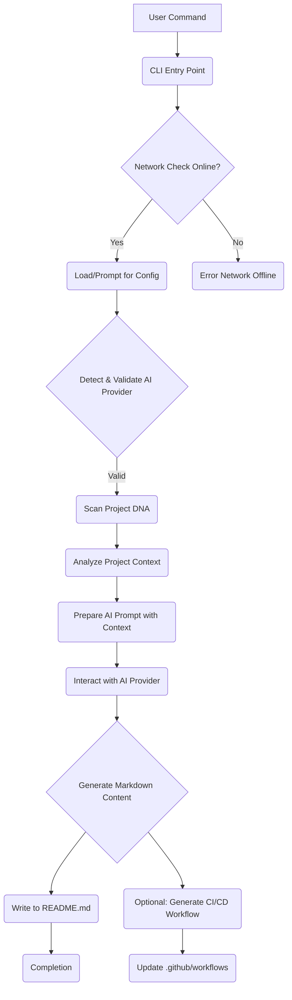

<div align="center">

# 📦 README GENESIS PRO

### Automated, Context-Aware Documentation for Technical Projects

[](https://nodejs.org/)
[](https://github.com/srikanta2006/readme-genesis/blob/main/LICENSE)
[](https://github.com/srikanta2006/readme-genesis/releases)

[Features](#features) • [Installation](#installation) • [Usage](#usage) • [Architecture](#architecture)

</div>

---

## ✨ Features

Generating project documentation manually is time-consuming and often leads to outdated or inconsistent READMEs. README GENESIS PRO automates this by:

*   **Intelligent Project Analysis:** Scans your project structure and code snippets to understand its core purpose and components.
*   **Multi-Model AI Integration:** Leverages leading LLMs (Gemini, OpenAI, Anthropic) to synthesize accurate, relevant, and human-readable documentation.
*   **CI/CD Workflow Generation:** Optionally sets up GitHub Actions to keep your `README.md` automatically updated with project changes.

### Quick Start

Generate a comprehensive README for your current project in one command:

```bash
npx readme-genesis
```

---

## 🚀 Recent Updates

*   **Multi-Provider AI Support:** Configurable integration with Gemini, OpenAI, and Anthropic models.
*   **Enhanced Context Awareness:** Deeper analysis of project files for more accurate and comprehensive READMEs.
*   **Human-Centric Responses:** Improved AI prompting for natural, engaging, and clear documentation.
*   **Robust Error Handling:** Implemented retry logic and validation for resilient AI interactions.
*   **GitHub-Compatible Diagrams:** Optimized Mermaid output for seamless rendering on GitHub.

---

## 🏗️ Architecture

README GENESIS PRO operates as a robust CLI application, orchestrating project analysis, AI model interaction, and documentation generation.

### Logic Flow



### Design Patterns

| Pattern                  | Purpose                                              | Implementation                                |
| :----------------------- | :--------------------------------------------------- | :-------------------------------------------- |
| **CLI Framework**        | Defines command structure and user interaction flow. | `commander`, `inquirer`                       |
| **Configuration Mgmt.**  | Persists user settings and API keys.                 | `Configstore`, `dotenv`                       |
| **Provider Abstraction** | Standardizes AI model interactions across vendors.   | `lib/factory.js`, `lib/providers/*.js`        |
| **Contextual Analysis**  | Extracts project metadata for AI input.              | `lib/analyzer.js` (`getProjectContext`)       |
| **State Management**     | Tracks project hashes for CI/CD relevance.           | `lib/state.js` (`calculateProjectHash`)       |

---

## 📁 Project Structure

```
.
├── bin/
│   └── index.js             # CLI Entry Point & Orchestrator
├── lib/
│   ├── analyzer.js          # Core: Project context analysis & content generation
│   ├── config.js            # Centralized AI model configurations (e.g., default model)
│   ├── factory.js           # AI Provider Factory: Manages provider instantiation
│   ├── providers/           # AI Provider Implementations (OpenAI, Gemini, Anthropic)
│   │   ├── anthropic.js
│   │   ├── base.js
│   │   ├── gemini.js
│   │   └── openai.js
│   └── state.js             # Project State Management: Calculates project hash for CI/CD
├── templates/
│   └── minimal.js           # Example README template structure
├── package.json             # Project metadata, scripts, and dependencies
├── README.md                # This documentation file
└── ...                      # Other development-related files (tests, demo assets)
```

---

## 🛠️ Setup & Usage

### Installation

Install `readme-genesis` globally for direct execution:

```bash
npm install -g readme-genesis
```

Alternatively, use `npx` to run without global installation:

```bash
npx readme-genesis
```

### Basic Usage

Navigate to your project's root directory and run the command:

```bash
cd my-awesome-project
npx readme-genesis
```

The CLI will guide you through provider configuration, model selection, and optional CI/CD setup.

### Configuration

`readme-genesis` prioritizes environment variables, then falls back to persistent configuration managed by `configstore`.

#### Environment Variables

| Variable             | Purpose                              | Default Value |
| :------------------- | :----------------------------------- | :------------ |
| `GEMINI_API_KEY`     | API key for Google Gemini provider.  | `N/A`         |
| `OPENAI_API_KEY`     | API key for OpenAI provider.         | `N/A`         |
| `ANTHROPIC_API_KEY`  | API key for Anthropic provider.      | `N/A`         |

#### CLI Options & Prompts

The interactive prompts allow you to configure these settings:

| Setting         | Description                                                          | Example Value                     |
| :-------------- | :------------------------------------------------------------------- | :-------------------------------- |
| `provider`      | Preferred AI provider (auto-detected if key is set).                 | `gemini`                          |
| `apiKey`        | Your API key for the selected provider.                              | `sk-xxxxxxxxxxxxxxxxxxxxxxxxxxxx` |
| `templateStyle` | Style of the generated README (e.g., `minimal`, `verbose`).          | `minimal`                         |
| `selectedModel` | Specific AI model to use (e.g., `gemini-2.5-flash`).                 | `gemini-2.5-flash`                |
| `authorPersona` | Describe the README author's style for AI guidance.                  | `concise, technical expert`       |
| `projectHook`   | Specific details or emphasis for the AI to include in the README.    | `focus on scalability`            |
| `ciCdPreference`| Opt-in to generate a GitHub Actions workflow for automated updates.  | `true`                            |

### Core Dependencies

| Tool         | Purpose                       | Version |
| :----------- | :---------------------------- | :------ |
| `commander`  | Node.js command-line interfaces | `^12.0.0` |
| `inquirer`   | Interactive user prompts      | `^9.0.0`  |
| `chalk`      | Terminal string styling       | `^5.0.0`  |
| `ora`        | Elegant terminal spinner     | `^8.0.0`  |
| `configstore`| Persist user settings         | `^6.0.0`  |
| `boxen`      | Create boxes in terminal      | `^7.0.0`  |
| `dotenv`     | Load environment variables    | `^16.0.0` |
| `mermaid.js` | Generates diagrams            | `^10.0.0` |

---

## 🗺️ Roadmap

Future enhancements for `README GENESIS PRO`:

*   [ ] **Custom Template Support:** Allow users to define and integrate their own EJS/Markdown templates.
*   [ ] **Expanded Language Analysis:** Improve context extraction for a wider range of programming languages and frameworks.
*   [ ] **Plugin Architecture for Providers:** Enable easier integration of new AI providers and custom logic.
*   [ ] **Interactive Markdown Editor:** Provide a local browser-based editor for post-generation refinement.
*   [ ] **Detailed Analytics Reporting:** Generate insights into project complexity and documentation coverage.